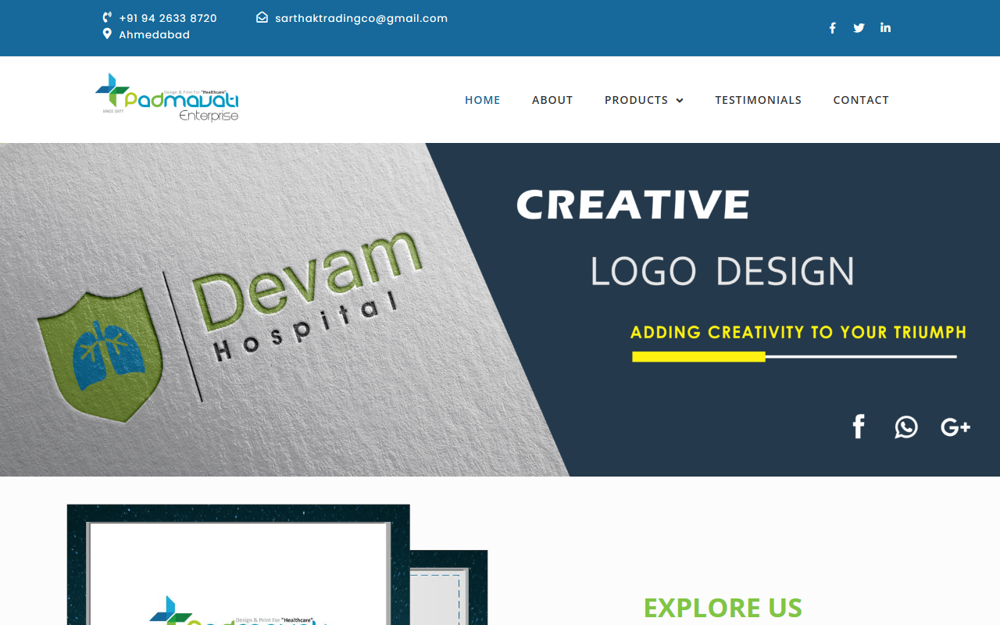

<div align="center">

# 🏥 Padmavati Enterprise — Healthcare Design & Print Platform

<p><strong>Official corporate platform for Padmavati Enterprise — leading healthcare branding, hospital stationery, and medical print specialists in Ahmedabad, India.</strong></p>

[](https://padmavatienterprise.com)
[-black?style=for-the-badge&logo=next.js&logoColor=white)](https://nextjs.org)
[](https://tailwindcss.com)
[](https://typescriptlang.org)
[](https://vercel.com)

<br />

<a href="https://padmavatienterprise.com">
  
</a>

<br /><br />

[**Visit Live Website ↗**](https://padmavatienterprise.com)

</div>

---

## 🎯 About The Project

**Padmavati Enterprise** has been delivering specialized healthcare design and pharmaceutical print solutions for over four decades—serving 2,000+ doctors, clinics, and multi-specialty hospitals across India.

This project is a modern, responsive web platform engineered using **Next.js 14 App Router** and **Tailwind CSS**. It provides an interactive portfolio showcase of hospital branding, brochure designs, prescription pads, and packaging, alongside direct inquiry channels via WhatsApp and Formspree.

---

## ✨ Features

- **⚡ Modern Next.js 14 App Router:** Server-Side Generation (SSG) with optimized Core Web Vitals and instant page transitions.
- **🖼️ Dynamic Portfolio Gallery:** Filterable showcase of medical logos, brochures, files, prescription designs, and hospital stationery.
- **📱 One-Click WhatsApp & Formspree Integration:** Direct inquiry triggers connecting prospective clients straight to sales and support.
- **🎨 Centralized Content Architecture:** Decoupled data layer in `lib/` allowing non-technical operators to update stats, testimonials, services, and photos without touching React components.
- **♿ Accessible & Mobile-First:** Full WCAG-conscious contrast, responsive layout for all viewports, and clean keyboard navigation.

---

## 🛠️ Tech Stack

| Layer | Technology |
|---|---|
| **Framework** | [Next.js 14](https://nextjs.org/) (App Router, Server Components) |
| **Language** | [TypeScript](https://www.typescriptlang.org/) |
| **Styling** | [Tailwind CSS](https://tailwindcss.com/) with custom healthcare brand palette |
| **Forms & Inquiries** | [Formspree](https://formspree.io/) API + WhatsApp Click-to-Chat protocol |
| **Hosting & CI/CD** | [Vercel](https://vercel.com) |

---

## 📁 Content Management (No-Code Content Updates)

All website copy, numbers, and client testimonials are centralized in the `lib/` directory:

| What to Update | Source File | Description |
|---|---|---|
| **Company Stats** | `lib/stats.ts` | Years in business, doctors served (2,000+), design counts |
| **Portfolio Items** | `lib/portfolio.ts` | Image tags, categories, client names, project titles |
| **Services Offered** | `lib/services.ts` | Design, branding, printing capabilities and descriptions |
| **Client Testimonials** | `lib/testimonials.ts` | Doctor recommendations, hospital quotes, and ratings |
| **Contact Information** | `lib/contact.ts` | Phone numbers, email addresses, studio address |
| **Brand Colors** | `tailwind.config.ts` | Primary healthcare teal, slate accents, and neutrals |

### Adding Portfolio Images

1. Export image as a `.jpg` or `.webp` (recommended minimum resolution: `800×600px`).
2. Save the file inside the `public/portfolio/` folder.
3. Add a new item to `lib/portfolio.ts` matching the filename.

---

## 🚀 Getting Started

### Prerequisites

- Node.js 18.x or 20.x
- npm or pnpm

### Installation

1. **Clone the repository:**
   ```bash
   git clone https://github.com/Kahaan83/Padmavati_website.git
   cd Padmavati_website
   ```

2. **Install dependencies:**
   ```bash
   npm install
   ```

3. **Configure Environment Variables:**
   Create a `.env.local` file in the root directory:
   ```env
   NEXT_PUBLIC_FORMSPREE_ID=your_formspree_id
   NEXT_PUBLIC_WHATSAPP_NUMBER=919426338720
   NEXT_PUBLIC_SITE_URL=https://padmavatienterprise.com
   ```

4. **Run the local development server:**
   ```bash
   npm run dev
   ```
   Open **`http://localhost:3000`** in your browser.

5. **Build for production:**
   ```bash
   npm run build
   ```

---

## 👤 Author & Client

- **Client:** Padmavati Enterprise (Ahmedabad, India)
- **Developer:** [Kahaan Shah](https://kahaanshah.in) · [@Kahaan83](https://github.com/Kahaan83)

---

## 📄 License

Proprietary client project — All rights reserved © Padmavati Enterprise.
